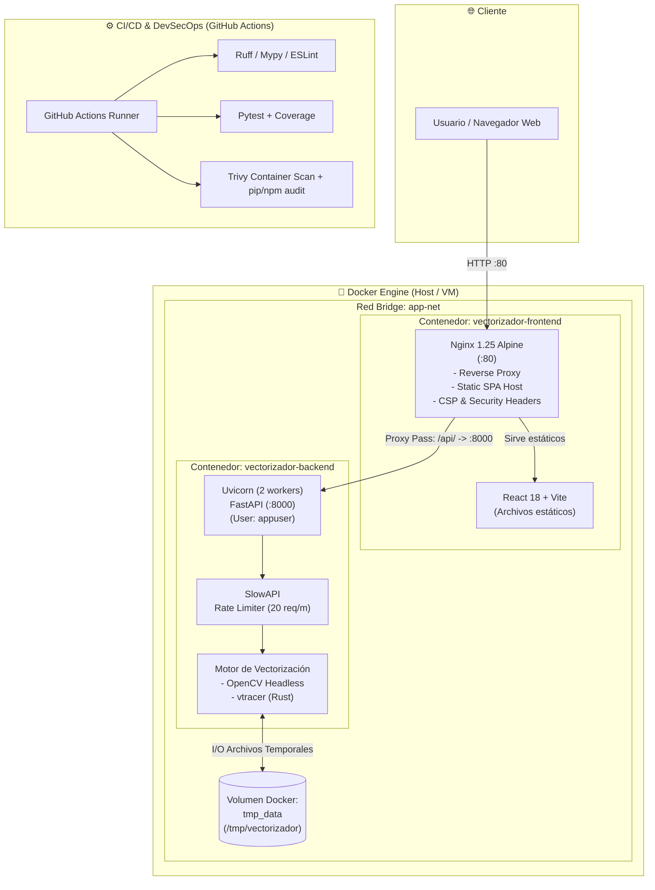

# VectorizadorSVG

> Convierte imágenes PNG, JPEG, WebP, GIF y BMP a vectores SVG de alta calidad.  
> Alternativa open source a vectorizer.ai · FastAPI + React + OpenCV + vtracer

[](https://github.com/pameeesd/vectorizador-svg/actions/workflows/ci.yml)
[](LICENSE)

---

## ✨ Características

| Feature | Detalle |
|---------|---------|
| 🎨 Vectorización en color | Colores reales → capas SVG apiladas |
| ◑ Modo binario | B&W con umbralización Otsu |
| 🔧 Parámetros ajustables | 8 controles en tiempo real |
| 🔒 Validación segura | Magic bytes, rate limiting, CSP, non-root Docker |
| 🐳 Docker Compose | Un comando para levantar todo |
| ⚡ CI/CD | Lint, tests, Trivy scan, npm audit en cada push |
| 📦 Sin dependencias externas de pago | 100% open source |

---

## 🛠️ Tecnologías y Herramientas

* **Frontend:** React 18, TypeScript, Vite 5, Lucide React, Nginx 1.25 Alpine.
* **Backend:** Python 3.12, FastAPI, Uvicorn, OpenCV (Headless), vtracer, NumPy, SlowAPI.
* **Contenerización & Red:** Docker, Docker Compose, Multi-stage builds, Bridge Network (`app-net`), Docker Named Volume (`tmp_data`).
* **Seguridad & Calidad:** Principio de menor privilegio (`non-root user`), Magic Bytes validation, Content Security Policy (CSP), Trivy Vulnerability Scanner, `pip-audit`, `npm audit`.
* **Testing & CI/CD:** GitHub Actions, Pytest, Codecov, Ruff, Mypy, ESLint.

---

## 🚀 Inicio rápido

### Con Docker (recomendado)

```bash
git clone https://github.com/pameeesd/vectorizador-svg.git
cd vectorizador-svg

# Configurar variables de entorno del backend
cp backend/.env.example backend/.env
# Edita backend/.env y cambia SECRET_KEY

docker compose up --build
```

Abre **http://localhost** en tu navegador.

### Desarrollo local

#### Backend (Python)

```bash
cd backend
python -m venv .venv
source .venv/bin/activate        # Windows: .venv\Scripts\activate
pip install -r requirements-dev.txt
cp .env.example .env              # Edita SECRET_KEY

uvicorn app.main:app --reload --port 8000
```

#### Frontend (React)

```bash
cd frontend
npm install
npm run dev
```

Abre **http://localhost:5173**

### Operaciones, Empaquetado y Verificación

```bash
# Construcción y levantamiento en segundo plano
docker compose up -d --build

# Verificación de salud y estado de contenedores
docker compose ps
curl -f http://localhost/health
curl -f http://localhost:8000/api/v1/vectorize/health

# Construcción manual e inspección de imágenes
docker build -t vectorizador-backend:local ./backend
docker build -t vectorizador-frontend:local ./frontend

# Escaneo local de vulnerabilidades en contenedor (Trivy)
docker run --rm -v /var/run/docker.sock:/var/run/docker.sock aquasec/trivy:latest image vectorizador-backend:local
```

---

## 🏗️ Arquitectura

### Diagrama de Flujo e Infraestructura

> 📐 Diagrama editable disponible en [`architecture.drawio`](architecture.drawio) (compatible con Diagrams.net / Draw.io).



### Estructura de Archivos

```
vectorizador-svg/
├── backend/
│   ├── app/
│   │   ├── api/        # Rutas FastAPI
│   │   ├── core/       # Config + Security
│   │   └── services/   # Lógica de vectorización (OpenCV + vtracer)
│   ├── tests/
│   ├── Dockerfile
│   └── requirements.txt
├── frontend/
│   ├── src/
│   │   ├── components/ # React UI
│   │   ├── hooks/      # useVectorizer
│   │   ├── types/      # TypeScript types
│   │   └── utils/      # API client
│   └── Dockerfile
├── .github/workflows/  # CI/CD + Security audit
├── docker-compose.yml
└── SECURITY.md
```

---

## 🔒 Seguridad

Ver [SECURITY.md](SECURITY.md) para reportar vulnerabilidades.

Medidas implementadas:

- ✅ Validación por **magic bytes** (no solo Content-Type)
- ✅ **Rate limiting** 20 req/min por IP
- ✅ CORS restringido a orígenes configurados
- ✅ **Archivos temporales** eliminados automáticamente tras cada request
- ✅ Docker con usuario **non-root**
- ✅ **Content-Security-Policy** en el frontend
- ✅ Auditoría de dependencias semanal (`pip-audit` + `npm audit` + Trivy)

---

## ⚙️ Parámetros de vectorización

| Parámetro | Descripción | Rango |
|-----------|-------------|-------|
| `color_mode` | `color` o `binary` | — |
| `filter_speckle` | Área mínima de caminos (px²) | 0–100 |
| `color_precision` | Bits por canal (solo color) | 1–8 |
| `layer_difference` | Luminancia mínima entre capas | 1–256 |
| `corner_threshold` | Ángulo de detección de esquinas | 1–180° |
| `length_threshold` | Longitud mínima de segmento | 0.1–10 |
| `max_iterations` | Iteraciones de simplificación | 1–50 |
| `splice_threshold` | Ángulo para fusionar segmentos | 1–180° |

---

## 🧪 Tests

```bash
cd backend
pytest tests/ -v --cov=app
```

---

## 🤝 Contribuir

1. Fork el repositorio
2. Crea una rama: `git checkout -b feature/mi-mejora`
3. Haz tus cambios y tests
4. Abre un Pull Request

---

## 🛠️ Bitácora de Errores y Soluciones

### [Docker Backend - Incompatibilidad de paquetes GLib en Debian/Python 3.12]
* **Problema:** Fallo durante la construcción de la imagen de Docker (`docker build ./backend`) al ejecutar `apt-get install -y libglib2.0-0 libgl1-mesa-glx`, arrojando error de paquete no encontrado o sin candidato de instalación.
* **Causa Raíz:** En las versiones recientes de la imagen base `python:3.12-slim` (Debian Trixie), se aplicó la transición de arquitectura a `time_t` de 64-bit, renombrando `libglib2.0-0` a `libglib2.0-0t64`. Además, `libgl1-mesa-glx` está descontinuada e innecesaria dado que se utiliza `opencv-python-headless`.
* **Solución Aplicada:** Se actualizó `backend/Dockerfile` reemplazando los paquetes del sistema por `libglib2.0-0t64` y removiendo `libgl1-mesa-glx`.

### [Vectorizer Service - Invocación errónea de parámetros en API de vtracer]
* **Problema:** Error `TypeError: convert_image_to_svg_py() got an unexpected keyword argument` en tiempo de ejecución al procesar la vectorización de imágenes.
* **Causa Raíz:** La firma del binding de Python de `vtracer` (>=0.6.0) no utiliza `input_path` ni `output_path`, sino `image_path` y `out_path`, y requiere especificar el modo de simplificación (`mode`).
* **Solución Aplicada:** En `backend/app/services/vectorizer.py`, se renombraron los argumentos a `image_path=input_path`, `out_path=output_path` y se añadió `mode="spline"`.

### [Vectorizer Service - Fondo blanco forzado al vectorizar imágenes con transparencia]
* **Problema:** Imágenes PNG con fondos transparentes generaban vectores SVG con un recuadro o fondo blanco sólido opaco, perdiendo la transparencia original y produciendo artefactos y halos de color en los contornos.
* **Causa Raíz:** En `backend/app/services/vectorizer.py`, la rutina inicial ejecutaba un alpha compositing forzado contra un fondo blanco (`white = np.ones_like(rgb) * 255`) sobre cualquier imagen con 4 canales. Adicionalmente, el motor `vtracer` genera por defecto un `<rect>` de fondo cubriendo el 100% del lienzo.
* **Solución Aplicada:** Se sustituyó la composición fija por detección dinámica de alfa (`has_transparency = np.any(alpha < 250)`), neutralizando píxeles transparentes (`clean_alpha == 0, :3 = 0`) para erradicar halos, preservando los 4 canales BGRA y aplicando `_clean_svg_background()` para remover mediante regex el `<rect>` de fondo blanco residual en el SVG final.

### [Nginx Ingress - Error 404/Fallback en llamadas a endpoints /api/]
* **Problema:** Peticiones HTTP desde el navegador o frontend hacia `/api/v1/...` recibían respuestas HTML (`index.html`) con código 200/404 en lugar de comunicarse con la API de FastAPI.
* **Causa Raíz:** El archivo `frontend/nginx.conf` carecía de un bloque `location /api/`, provocando que el enrutamiento cayera en la regla general SPA `try_files $uri $uri/ /index.html`.
* **Solución Aplicada:** Se añadió el bloque `location /api/` con `proxy_pass http://backend:8000;`, cabeceras de proxy (`Host`, `X-Real-IP`, `X-Forwarded-For`) y `client_max_body_size 10M;` en `frontend/nginx.conf`.

### [Frontend TypeScript - Tipado no reconocido para entorno Vite]
* **Problema:** Fallo en la verificación estática de tipos (`npx tsc --noEmit`) en frontend por falta de definiciones globales para `import.meta.env` y utilidades de Vite.
* **Causa Raíz:** `frontend/tsconfig.json` no incluía la referencia a las definiciones de tipos del cliente de Vite en su matriz de compilación.
* **Solución Aplicada:** Se agregó `"types": ["vite/client"]` dentro del bloque `compilerOptions` en `frontend/tsconfig.json`.

### [CI/CD Pipeline - Triggers inactivos en master, permisos SARIF y dependencias GLib]
* **Problema:** El pipeline de GitHub Actions no se ejecutaba tras hacer push a la rama principal (`master`), y presentaba riesgo de fallo en la subida de reportes SARIF a CodeQL y la instalación de dependencias del sistema en runners modernos de Ubuntu.
* **Causa Raíz:** En `.github/workflows/ci.yml`, los filtros de ramas solo contemplaban `main`, el workflow carecía del permiso `security-events: write` para el action `upload-sarif`, y la instalación de GLib para OpenCV headless no contemplaba la transición de paquetes a `libglib2.0-0t64`.
* **Solución Aplicada:** Se agregó `master` a los triggers de `push` y `pull_request`, se habilitó `security-events: write` a nivel de workflow, se ajustó la condición de ejecución de `docker-scan` y se implementó la instalación con fallback `libglib2.0-0t64 || libglib2.0-0`.

### [CI/CD Pipeline - Dependencias dev de backend y ausencia de lockfile en frontend]
* **Problema:** Fallo en los jobs `Backend · Lint & Test` (error `ruff: command not found`) y `Frontend · Lint & Build` (`npm error The npm ci command can only install with an existing package-lock.json`) en GitHub Actions.
* **Causa Raíz:** `backend/requirements-dev.txt` no incluía las herramientas de análisis estático (`ruff`, `mypy`, `pytest-cov`), y el runner de frontend invocaba `npm ci` sin existir un `package-lock.json` en el repositorio.
* **Solución Aplicada:** Se añadieron `ruff>=0.4.0`, `mypy>=1.10.0` y `pytest-cov>=5.0.0` en `backend/requirements-dev.txt`, y se modificó `npm ci` por `npm install` en `.github/workflows/ci.yml` y `.github/workflows/security-audit.yml`.

---

## 📄 Licencia

MIT © 2026 [pameeesd](https://github.com/pameeesd)
